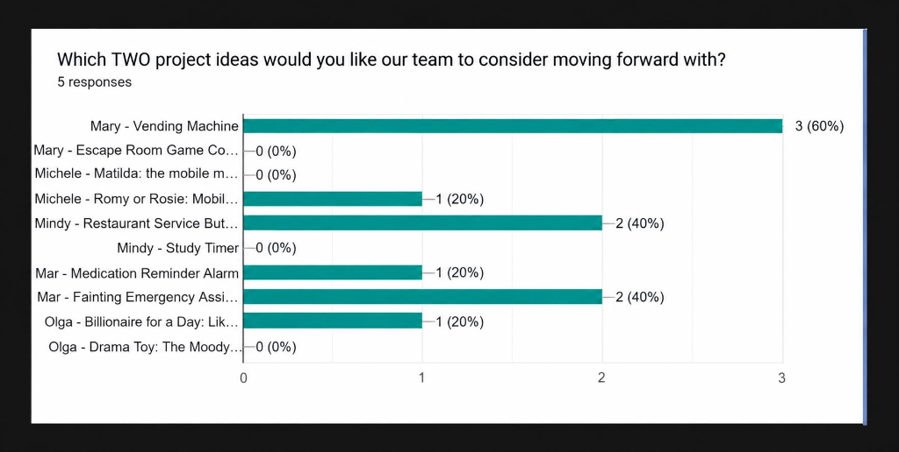

# MobileMiniMart

**FIU | Master of Science in Information Systems (MSIS) — Systems Analysis**  
*Project Name:* MobileMiniMart (formerly Vendigo)  
*Team Name:* **M4O** (Mary, Mindy, Michele, Mar, Olga)  
*Hardware Platform:* Raspberry Pi Pico (MicroPython)  

---

## 📌 Project Overview
**MobileMiniMart** is an intelligent, autonomous mobile vending machine built around the Raspberry Pi Pico microcontroller. It combines autonomous mobility and obstacle avoidance with an interactive customer vending interface. The machine cruises to designated customer zones, detects approaching customers, and allows users to browse snacks and beverages, confirm purchases with physical button and knob controls, and receive real-time audio-visual feedback through an LCD display, NeoPixel LED strip, and piezo buzzer.

---

## 🗳️ Project Selection & Feasibility Analysis
During the initial project initiation phase, Team M4O conducted a structured feasibility evaluation and team voting survey to evaluate multiple potential project concepts. 

The **Smart Vending Machine** was democratically selected as our official group project, winning first place with **60% of the team's votes**.

* **Live Survey:** [MobileMiniMart Google Forms Survey](https://forms.gle/axzZoBqZDT1qez4K9)
* **Survey Results Chart:**



---

## 📋 Proposal Documentation & Artifacts
* **Project Proposal Document:** [`Project Proposal - Ideas.docx`](Project%20Proposal%20-%20Ideas.docx)
* **High-Resolution UML Diagram:** [`Vendigo UML Diagram.png`](Vendigo%20UML%20Diagram.png)
* **Customer Requirements Survey:** [Google Forms Link](https://forms.gle/axzZoBqZDT1qez4K9)

---

## 📐 System Architecture (UML Class Diagram)
The system is modeled following a 12-class object-oriented architecture with full multiplicity constraints:


### The 12 System Classes:
1. **Master System Controller:**
   * `vending_machine.py` (`MobileVendingMachine`): Central coordinator linking the inventory, customer peripherals, and mobility navigation controllers.
2. **Autonomous Mobility & Navigation Layer:**
   * `navigation_controller.py` (`NavigationController`): Manages autonomous cruising speed, path clearance checks, and collision avoidance maneuvers.
   * `obstacle_sensor.py` (`ObstacleSensor`): Ultrasonic distance sensor (HC-SR04) using echolocation to measure obstacle and customer proximity.
   * `movement_controller.py` (`MovementController`): Differential dual-motor controller handling forward, reverse, pivot steering, and stopping.
   * `motor.py` (`Motor`): Direct H-Bridge DC motor driver with PWM speed regulation.
3. **Customer Interface & Peripherals Layer:**
   * `lcd.py` (`LCD`): 16x2 I2C text display for rendering product names, prices, and stock quantities.
   * `knob.py` (`Knob`): 16-bit analog potentiometer ADC knob for scrolling through the snack catalog.
   * `led_strip.py` (`LEDStrip`): NeoPixel RGB status lights (Green = Ready, Yellow = Low Stock, Red = Out of Stock).
   * `buzzer.py` (`Buzzer`): Piezo PWM buzzer emitting high-pitch success chimes and low-pitch error buzzes.
   * `button.py` (`Button`): Digital push-button with 200ms software debouncing for purchase confirmation.
4. **Snack & Inventory Data Model Layer:**
   * `product.py` (`Product`): Represents an individual snack or drink with price and inventory stock validation.
   * `inventory.py` (`Inventory`): Manages product collection and configurable low-stock alert thresholds.

---

## 🚀 Running the Full Demonstration
The repository contains an end-to-end simulation script demonstrating the complete MobileMiniMart workflow:

```bash
python main.py
```

### Running Individual Class Verification Tests
Every class file includes a self-contained test execution block verifying assertions:

```bash
python product.py
python inventory.py
python vending_machine.py
python navigation_controller.py
python movement_controller.py
python obstacle_sensor.py
python motor.py
python lcd.py
python knob.py
python led_strip.py
python buzzer.py
python button.py
```
